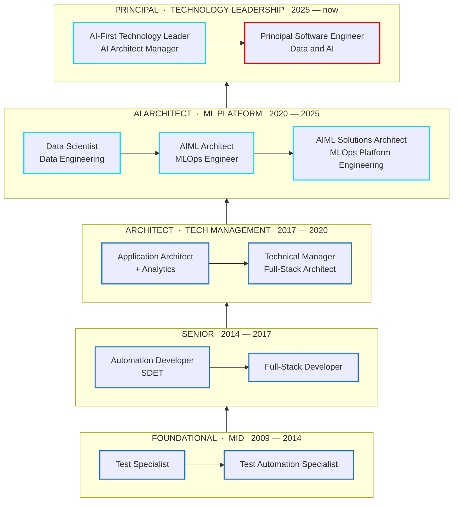

<div align="center">

### *A true Full-Stack architect who is an Engineer first.*

**A complete full stack** — `Full-Stack` **+** `AI/ML` **+** `Data Science` **+** `Agentic`
<!-- 
### *I've built every layer I design , making sure it doesn't break — and if it does, I'm the one who gets it running again.* -->

**IC · Technology Leader · Engineering Manager** — whichever seat the problem needs.
Not mutually exclusive, usually juggling .


</div>

<!-- PARKED — career trajectory, to place further down the page later:
`Testing` → `Automation Developer` → `Front-End Engineer` → `Full Stack` → `Data Scientist` → `AI Architect` → `ML Engineer` → `ML Platform Engineering` → `Agentic Engineering` → `Agent Platform Development` → `Technology Leader` → `Principal Software Engineer`
-->

---

## About

Principal Software Engineer on Red Hat's **Data & AI** team.

I build and run **AI Factory** — the internal agentic platform Red Hat engineers use to get agents into production. Control plane, edge gateway, and the agent + UI templates every agent on it starts from. I designed its agent evaluation framework. My team builds it; I'm in the code with them.

**I came to agents through the models, not around them.** Six years at **Ericsson R&D** — data scientist first: exploratory analysis, anomaly detection tuned for telco data, machine reasoning, model selection, monitoring, retraining, the whole model lifecycle. Then the layer underneath: architected a cloud-native **MLOps platform** from scratch and owned it as product owner, then led the engine that took it to parity with Vertex AI and SageMaker. MLflow, Kubeflow, Seldon, KServe, Argo — the plumbing that carries a model from **ideation to industrialization**. Traditional AI and GenAI both; I didn't skip the first to get to the second.

Now the same discipline one layer up. **RAG and Graph RAG**, vector stores, **LangGraph** and **MCP**, fine-tuning, SLM-vs-LLM benchmarking, LLM-as-judge evaluation. Agentic systems are still ML systems — same rigour needed on data, evaluation and drift — with one new problem: they're **probabilistic apps**, and they fail in ways deterministic software never did.

Which is why I spend as much time on **reliability** as on features: chaos testing, circuit breakers, and the unglamorous work that keeps agentic systems standing up.

Seventeen years to get here, and I've been the IC, the lead and the manager along the way — often at the same time. The through-line is **production**, not demos.

**Why this matters now.** Agents have democratized code generation and UI work — the low-hanging GenAI use cases are already picked. What's left needs enterprise architecture thinking, proven design patterns and production-grade engineering discipline. That's the part I spent seventeen years learning, one layer at a time.

## Stack

Top of the stack down to the foundations — the order I learned it in reverse.

```yaml
agentic:
  frameworks:   LangGraph | LangChain | Deep Agents | Strands | MCP (server + client)
  platform:     control plane | edge gateway | agent & UI templates | Aegra runtime
  retrieval:    RAG | Graph RAG | vector stores | ONNX embeddings
  evaluation:   LLM-as-judge | Promptfoo | Lightspeed benchmarks | KEDA-scaled eval runners
  models:       Claude | Gemini | open-source SLMs | fine-tuning | SLM-vs-LLM benchmarking
  governance:   OPA policy | guardrails | HITL approval | AI security

ai_ml:
  data_science: EDA | anomaly detection | correlation | machine reasoning | feature analysis
  modelling:    model selection & tuning | monitoring | retraining | drift | full model LCM
  mlops:        MLflow | Kubeflow | Seldon | KServe | Argo Workflows
  clouds:       AWS SageMaker | Bedrock AgentCore | GCP Vertex AI | Google Agent Engine

data:
  pipelines:    Kafka | RabbitMQ | PySpark | Logstash
  stores:       PostgreSQL | MongoDB | Valkey | Redis | Elasticsearch / OpenSearch
  warehouse:    Snowflake | S3 | Oracle | CouchDB | SQLite

platform:
  orchestration: Kubernetes | OpenShift | Helm | Kustomize | Argo CD | Argo Rollouts | Tekton
  scaling:       HPA | KEDA | blue-green | multi-cluster routing
  local:         Kind | Podman | Docker

reliability:
  chaos:         Toxiproxy | fault injection | blue-deployment isolation
  patterns:      circuit breakers | distributed semaphores | leader election
                 graceful drain | reconciliation loops | connection pooling
  observability: OpenTelemetry | Prometheus | Grafana | Langfuse
                 Sumo Logic | Datadog | structlog | Alertmanager

security:
  identity:      SSO | OIDC | OAuth2 + DCR | Keycloak | LDAP | RBAC / ABAC
  secrets:       HashiCorp Vault | ArgoCD Vault Plugin
  appsec:        SSRF protection | CVE remediation | four-eyes approval | audit logging

engineering:
  languages:     Python | Java | JavaScript | SQL | Bash
  backend:       FastAPI | Pydantic | Spring Boot | Spring MVC | Node | Express
  frontend:      React | PatternFly | Redux | Angular | Fastify BFF | SSE streaming
  testing:       pytest | Playwright | Selenium | BDD | chaos suites
  ci_cd:         GitHub Actions | GitLab CI | Tekton | Argo CD
```

## Red Hat Data & AI — Template Repositories 


| Repository | What it is | Role | Stars |
|---|---|---|---|
| [**template-agent**](https://github.com/redhat-data-and-ai/template-agent) | LangGraph agent template with enterprise security and Kubernetes deployment built in | Maintainer |  |
| [**template-ui**](https://github.com/redhat-data-and-ai/template-ui) | Agent UI that works out of the box with template-agent, extensible to any AI agent | Maintainer |  |

## Work



| | Years | Role |
|---|---|---|
|  | **2026 — Present** | **Principal Software Engineer · Data & AI**<br>Agentic platform engineering — control plane, edge gateway, agent & UI templates, agent evaluation framework, and the reliability work that keeps it in production. |
|  | **2020 — 2026** | **AI-First Technology Leader · AI Architect Manager** · 2025–26<br>**AIML Solutions Architect · MLOps Platform Engineering** · 2022–25<br>**AIML Architect · MLOps Engineer** · 2022<br>**Data Scientist** · 2020–21<br>Cloud-native MLOps platform built from scratch and owned as PO. Anomaly detection and correlation for telco data. GenAI and traditional AI use cases taken to production. |
|  | **2009 — 2020** | **Technical Manager · Full-Stack Architect**<br>**Application Architect + Analytics**<br>**Full-Stack Application Developer**<br>**Automation Developer · SDET**<br>**Test Specialist**<br>Eleven years, six rungs. MEAN-stack enterprise applications, automation and migration frameworks, Python/Pandas analytics tooling. Onsite in the US as client SPOC. |

> Red Hat is an IBM entity — Red Hat through Sep 2026, IBM CIO from Oct 2026, same team and same platform throughout.

## Blogs

- [**Everyone Has an F1 Car. Not Everyone Can Drive.**](https://medium.com/@nirmalchandhar/everyone-has-an-f1-car-not-everyone-can-drive-252991162b3c) 
- [**Prompt Debt: The Token Tax of Regenerative Code**](https://medium.com/@nirmalchandhar/prompt-debt-the-token-tax-of-regenerative-code-2ebd6b51962e) 

## Contact

<div align="center">

<a href="https://www.linkedin.com/in/nirmal-manikandan-33b48417/">
  
</a>
<a href="mailto:nirmalchandhar@gmail.com">
  
</a>

**Nearly a decade in Data & AI.**
Currently building large-scale, enterprise agentic systems for production.

**Happy to talk.**

</div>
